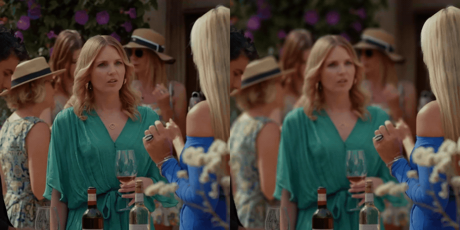
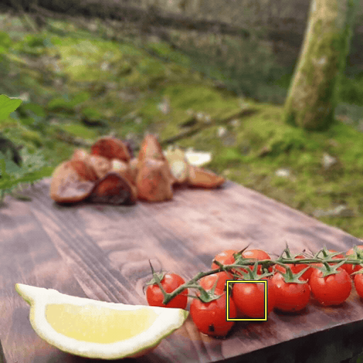
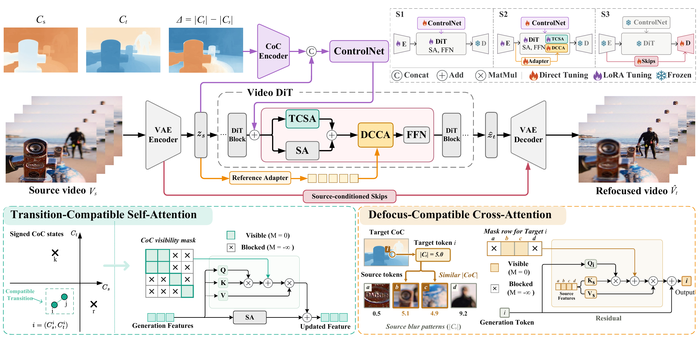

<h1 align="center">RefocusCraft: Unified Video Refocusing via CoC-Guided State Transitions</h1>

<strong>CVPR 2027 Submission</strong>

  <a href="https://refocuscraft.github.io/"><strong>Project Page</strong></a>
  &nbsp;|&nbsp;
  <a href="https://refocuscraft.github.io/#project-video"><strong>Full Video</strong></a>
  &nbsp;|&nbsp;
  <a href="https://refocuscraft.github.io/#visual-results"><strong>Interactive Results</strong></a>

RefocusCraft directly transforms a source video into a target defocus state, without first reconstructing an all-in-focus intermediate. A unified model supports **defocus deblurring, bokeh synthesis, and refocusing**, with source and target circle-of-confusion (CoC) maps controlling the desired transition.

This repository hosts the visual demonstration assets for RefocusCraft. The project page provides the complete interactive presentation.

## Video Refocusing

  

Source-to-target refocusing with preserved scene details. The [project page](https://refocuscraft.github.io/#visual-results) provides synchronized video playback, draggable comparisons, and enlarged views.

## Focus Transitions

  

Change the target focus over time while keeping the underlying video scene. Explore [focus and blur-strength controls](https://refocuscraft.github.io/#focus-control-title) and [focus-transition examples](https://refocuscraft.github.io/#focus-motion-title).

## Method

  

- **Unified state transitions:** signed source and target CoC maps guide a pretrained video diffusion backbone to predict the target video in a single forward pass.
- **Compatible feature interactions:** transition-compatible self-attention (TCSA) and defocus-compatible cross-attention (DCCA) constrain feature aggregation according to the desired defocus transition.
- **Source-conditioned decoding:** fine-grained source features preserve textures and object boundaries in the output.

## Results

On the synthetic **refocusing** test set:

| Method | PSNR ↑ |
| --- | ---: |
| GenFocus | 28.50 dB |
| **RefocusCraft** | **33.39 dB** |

RefocusCraft improves PSNR by **4.89 dB** over GenFocus on this task.

**Inference:** **2.36 seconds** for a **25-frame, 512 × 512** video on an **NVIDIA A800**, with **precomputed conditions**. See the [efficiency comparison](https://refocuscraft.github.io/#efficiency-title) for the evaluation setting and other methods.

The [project page](https://refocuscraft.github.io/) also includes real-world comparisons, fine-detail inspection, and temporal-consistency visualizations.
